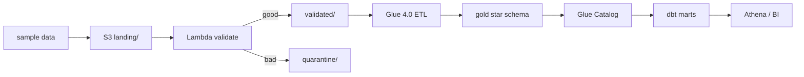

# Production-Grade AWS Data Pipeline Starter Kit

A deployable template for a batch lakehouse pipeline on AWS. Drop in your data sources, run Terraform, and you get event-driven validation, a Spark medallion transform, a cataloged star schema, and dbt-built business marts — with CI/CD and cost guardrails from day one. It's the shape of pipeline I've built for real analytics teams, minus the months of boilerplate.

## What's inside

- **Sample data generator** (`scripts/`) — synthetic orders/customers/products so you can prove the pipeline works before wiring real sources
- **S3 landing zone** — `landing/` → validated or quarantined by an event-driven **Lambda** (`data-pipeline-kit-dev-ingest`), with CloudWatch metrics on every outcome
- **Glue 4.0 PySpark job** (`data-pipeline-kit-dev-etl-job`) — bronze → silver → gold medallion transform building a star schema: `dim_customer` (SCD2), `dim_product` (SCD1), `dim_date`, `fact_orders`
- **Glue Data Catalog** (`data_pipeline_kit_dev`) — one schema registry for Athena, dbt, and BI tools
- **dbt on Athena** — SQL-modeled business marts with tests and docs, queryable through the `data-pipeline-kit-dev-wg` workgroup
- **Terraform** (`terraform/`) — all infrastructure as code; environments via tfvars
- **GitHub Actions** — PR checks (terraform fmt/validate, Python compile, Lambda unit tests, dbt parse) and a main-branch deploy (terraform apply + dbt build via OIDC)



## Quickstart

**Prerequisites:** AWS CLI (authenticated), Terraform ≥ 1.5, Python 3.11. Times are honest estimates on a typical setup.

1. **Generate sample data** (~1 min): `make sample-data` — writes synthetic events to a local directory.
2. **Provision infrastructure** (~10–20 min, mostly AWS creating resources): `make tf-init`, `make tf-plan`, `make tf-apply`. Buckets, Lambda, Glue job, catalog, and Athena workgroup are created.
3. **Run the pipeline** (~5–10 min): upload the sample data to the raw bucket's `landing/` prefix (triggers Lambda validation), or start the Glue job directly with `make glue-run`.
4. **Build dbt marts**: `make dbt-local` (~2 min, duckdb, no AWS) to check the models, or `make dbt-prod` for the real Athena build.
5. **Query in Athena**: open the Athena console, select the `data-pipeline-kit-dev-wg` workgroup and the `data_pipeline_kit_dev` database, and query the gold tables and marts.

See `docs/architecture.md` for the full data flow, `docs/data-modeling.md` for the star schema and SCD design, and `docs/costs.md` before you leave anything running.

## Project structure

```
.
├── .github/workflows/   # pr-checks.yml (CI), deploy.yml (CD via OIDC)
├── data-quality/        # validation expectations and checks
├── dbt/                 # dbt project: staging + mart models on Athena
├── docs/                # architecture, data-modeling, costs, extending
├── glue/                # PySpark ETL job (bronze → silver → gold)
├── lambda/              # ingest validator + unit tests
├── scripts/             # sample data generator
├── terraform/           # infrastructure as code (vars: project_name, environment, aws_region, glue_worker_type, glue_num_workers)
├── Makefile             # common operations (see `make help`)
├── .gitignore
├── README.md
└── LICENSE
```

## Testing

- `make test-lambda` — runs the Lambda unit tests (`python -m unittest discover -s lambda/tests`)
- `make validate-gx` — runs the Great Expectations suite if installed
- PR checks compile-check all Python, run the Lambda tests, `terraform validate`, and `dbt parse` on a local duckdb target — see `.github/workflows/pr-checks.yml`

## CI/CD

- **PRs:** `pr-checks.yml` runs terraform fmt/validate, Python compile checks, Lambda unit tests, and dbt parse. Nothing merges red.
- **Main:** `deploy.yml` assumes an AWS IAM role via OIDC (configure `AWS_DEPLOY_ROLE_ARN` first — see the workflow's header comment), runs `terraform apply`, then `dbt build --target prod`.

## Costs

Realistic estimates live in `docs/costs.md`: roughly **$5–15/mo** for dev/idle and **$50–150/mo** for small production, each labeled estimate — check current AWS pricing. The kit ships with Athena workgroup limits, S3 lifecycle guidance, and partition pruning to keep the bill boring.

## Extending

`docs/extending.md` covers: adding a new source end-to-end, converting `dim_product` to SCD Type 2, a streaming sketch (Kinesis + Glue streaming), orchestration with MWAA/EventBridge Scheduler, swapping Parquet for Iceberg, and multi-environment tfvars.

## License

MIT — see `LICENSE`. Copyright (c) 2026 Harish Reddy Singi Reddy.
