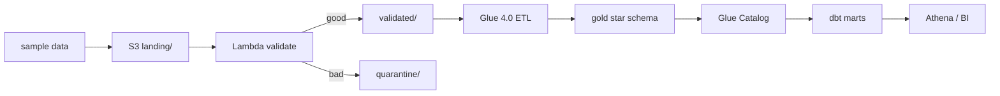
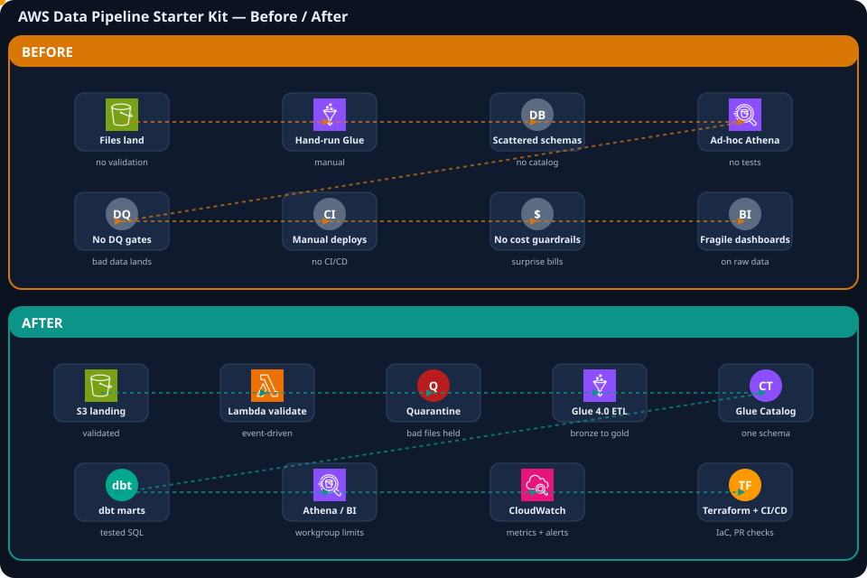

# Production-Grade AWS Data Pipeline Starter Kit

A deployable template for a batch lakehouse pipeline on AWS. Drop in your data sources, run Terraform, and you get event-driven validation, a Spark medallion transform, a cataloged star schema, and dbt-built business marts — with cost guardrails from day one. It's the shape of pipeline I've built for real analytics teams, minus the months of boilerplate. There is no CI/CD configured in this repo (no workflow files ship with it); the checks to run before a deploy are listed under [Checks before you deploy](#checks-before-you-deploy).

## What's inside

- **Sample data generator** (`scripts/`) — synthetic orders/customers/products so you can prove the pipeline works before wiring real sources
- **S3 landing zone** — `landing/` → validated or quarantined by an event-driven **Lambda** (`data-pipeline-kit-dev-ingest`), with CloudWatch metrics on every outcome
- **Glue 4.0 PySpark job** (`data-pipeline-kit-dev-etl-job`) — bronze → silver → gold medallion transform building a star schema: `dim_customer` (SCD2), `dim_product` (SCD1), `dim_date`, `fact_orders`
- **Glue Data Catalog** (`data_pipeline_kit_dev`) — one schema registry for Athena, dbt, and BI tools
- **dbt on Athena** — SQL-modeled business marts with tests and docs, queryable through the `data-pipeline-kit-dev-wg` workgroup
- **Terraform** (`terraform/`) — all infrastructure as code; environments via tfvars
- **Tests** (`tests/`, `lambda/tests/`) — stdlib `unittest` suites covering the shared package, the Lambda, and the Glue modules; run with `make test`, no AWS account or third-party packages needed



## Architecture — Before / After

Hover any component to see what it is and why it is needed.


<details>
<summary><b>Ingest, validate and transform — click to expand the 4 steps</b></summary>

Collapsed, this is just: S3 landing -> Lambda validate -> Quarantine -> Glue 4.0 ETL

1. A file lands in the S3 landing zone.
2. The Lambda validator fires on arrival and checks the file, recording every outcome in CloudWatch.
3. Bad files go to quarantine, held apart instead of landing; only validated files move on.
4. The Glue 4.0 PySpark job transforms bronze to silver to gold, building the star schema (dim_customer SCD2, dim_product SCD1, dim_date, fact_orders).
</details>

### Earlier issues, risk, and impact after

| Aspect | Detail |
|---|---|
| Earlier issues | Files landed with no checks, so bad data flowed downstream unnoticed; a Glue job run by hand with no schedule, so runs were easy to miss; tables lived in scattered places with no shared catalog, so teams guessed at schemas; queries ran directly on raw tables with no tests; changes were deployed by hand with no checks; no cost limits or lifecycle rules; dashboards read raw data directly. |
| Risk | Bad data could reach dashboards and decisions before anyone noticed; a bad deploy could break the pipeline; costs could grow unnoticed; one upstream change could break every dashboard at once. |
| Impact after | Every file is validated on arrival and bad files are quarantined before they can land; the medallion transform builds a catalogued star schema in one place; dbt marts carry tests and docs; Athena workgroup limits and CloudWatch metrics keep cost and failures visible; Terraform makes deploys repeatable. |


## Quickstart


**Prerequisites:** AWS CLI (authenticated), Terraform ≥ 1.5, Python 3.11. Times are honest estimates on a typical setup.

1. **Generate sample data** (~1 min): `make sample-data` — writes synthetic events to a local directory.
2. **Provision infrastructure** (~10–20 min, mostly AWS creating resources): `make tf-init`, `make tf-plan`, `make tf-apply`. Buckets, Lambda, Glue job, catalog, and Athena workgroup are created.
3. **Run the pipeline** (~5–10 min): upload the sample data to the raw bucket's `landing/` prefix (triggers Lambda validation), or start the Glue job directly with `make glue-run`.
4. **Build dbt marts**: `make dbt-local` (~2 min, duckdb, no AWS) to check the models, or `make dbt-prod` for the real Athena build.
5. **Query in Athena**: open the Athena console, select the `data-pipeline-kit-dev-wg` workgroup and the `data_pipeline_kit_dev` database, and query the gold tables and marts.

See `docs/architecture.md` for the full data flow, `docs/data-modeling.md` for the star schema and SCD design, and `docs/costs.md` before you leave anything running.

## Project structure

```
.
├── src/pipeline_kit/  # shared stdlib-only package: config, validation, retry, transforms, generator, metrics
├── tests/             # unit tests for the shared package + Glue modules + mirror-sync checks
├── data-quality/      # validation expectations and checks
├── dbt/               # dbt project: staging + mart models on Athena
├── docs/              # architecture, data-modeling, costs, extending
├── glue/              # thin driver (etl_job.py) + etl/ package (bronze → silver → gold)
├── lambda/            # ingest validator (src/: app, config, validation, retry) + unit tests
├── scripts/           # sample data generator (thin CLI over src/pipeline_kit/generator.py)
├── terraform/         # infrastructure as code (vars: project_name, environment, aws_region, glue_worker_type, glue_num_workers)
├── Makefile           # common operations (see `make help`)
├── pyproject.toml     # packaging metadata (src layout) + optional dev deps
├── .gitignore
├── README.md
└── LICENSE
```

## Testing

- `make test` — runs the full suite (`python3 tests/run_tests.py`): the shared `src/pipeline_kit` package, the Lambda tests, the Glue module tests, and the mirror-sync checks. Stdlib `unittest` only; `boto3` and `pyspark` are stubbed in-process, so it needs no AWS credentials, no network, and no third-party packages. `pytest` can also collect these tests when installed (`pip install -r requirements-dev.txt`), but it is not required.
- `make test-lambda` — Lambda tests only.
- `make validate-gx` — runs the Great Expectations suite against generated sample data if GX is installed (skips with a message otherwise).
- `bash scripts/run_local_demo.sh` — end-to-end smoke test: generates sample data, runs the full test suite, then GX validation when available.

What the tests cover: record validation rules and their edge cases, retry/backoff behaviour, run-date and bucket-name validation, surrogate-key and line-total math (the same rules the Spark job implements), sample-data determinism and validity, Glue argument parsing and S3 helpers (with Spark stubbed), the orphan-rate quality gate, and that the Lambda/Glue mirrored copies agree with the shared package. The Spark transform bodies themselves are not executed locally — there is no Spark here — so a Glue change still needs a real Glue run to prove end to end.

## Checks before you deploy

No CI is configured in this repo, so run these by hand before `terraform apply`:

- `make test` — unit tests (see above)
- `python3 -m compileall src glue lambda scripts data-quality` — every Python file compiles
- `terraform fmt -check -recursive && terraform -chdir=terraform validate` — formatting and config (needs Terraform installed)
- `cd dbt && dbt parse --target local` — dbt project parses (needs dbt installed)

## Packaging notes

- The Lambda is deployed as a zip of the whole `lambda/src` directory (Terraform `archive_file`), handler `app.handler`. The modules in that directory are self-contained: `validation.py` and `retry.py` are mirrored copies of `src/pipeline_kit/validation.py` and `src/pipeline_kit/retry.py`, kept in sync by `tests/test_mirrors.py`.
- The Glue job script (`glue/etl_job.py`) is a thin driver. Its helper modules (`glue/src/etl/`) are packaged as a zip and passed to the job via `--extra-py-files` (see `terraform/glue.tf`); `make glue-package` builds the same zip locally for inspection.
- Re-runs are idempotent by construction: the Lambda derives deterministic output keys from the source key, and the Glue job overwrites whole `dt=` partitions / full snapshots instead of appending.

## Synthetic data

All sample data in this repo is synthetic: invented names from fixed pools, `example.com` email addresses, and generic product names, generated deterministically from a seed (`scripts/generate_sample_data.py`, default seed 42). No real customer, company, or location data is used anywhere. The pipeline itself is source-agnostic — replace the generator with your real producers.

## Costs

Realistic estimates live in `docs/costs.md`: roughly **$5–15/mo** for dev/idle and **$50–150/mo** for small production, each labeled estimate — check current AWS pricing. The kit ships with Athena workgroup limits, S3 lifecycle guidance, and partition pruning to keep the bill boring.

## Extending

`docs/extending.md` covers: adding a new source end-to-end, converting `dim_product` to SCD Type 2, a streaming sketch (Kinesis + Glue streaming), orchestration with MWAA/EventBridge Scheduler, swapping Parquet for Iceberg, and multi-environment tfvars.

## License

MIT — see `LICENSE`. Copyright (c) 2026 Harish Reddy Singi Reddy.
