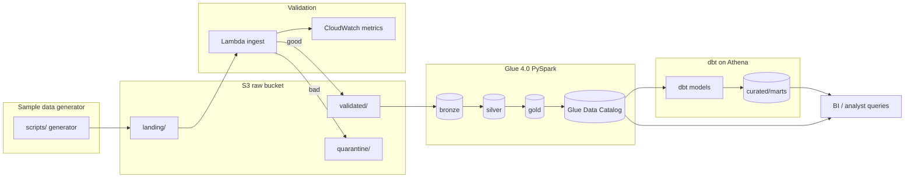

# Architecture

This kit implements a batch lakehouse pipeline on AWS: raw events land in S3, get validated, and are transformed through bronze → silver → gold layers into a star schema you can query with Athena and model further with dbt.

## Pipeline diagram

## Components

| Component | What it does | Why it was chosen |
|---|---|---|
| Sample data generator (`scripts/`) | Produces synthetic order/customer/product events so you can exercise the whole pipeline without real data | Lets you validate the deploy end-to-end before wiring real sources |
| S3 raw bucket (`data-pipeline-kit-dev-raw`) | Holds `landing/` (incoming), `validated/` (schema-conformant), `quarantine/` (rejected) | S3 is the durable, cheap landing zone; prefixes isolate raw, good, and bad records |
| Lambda (`data-pipeline-kit-dev-ingest`) | Triggered on new `landing/` objects; validates records, routes good → `validated/`, bad → `quarantine/`, emits CloudWatch metrics | Serverless, event-driven validation keeps bad data out of the warehouse before expensive Spark compute touches it |
| CloudWatch | Metrics from Lambda (records in/out, validation failures, latency) | Cheap, zero-setup observability for the ingestion path |
| Glue 4.0 PySpark job (`data-pipeline-kit-dev-etl-job`) | Bronze → silver → gold: cleans, deduplicates, and builds the star schema (`dim_customer` SCD2, `dim_product` SCD1, `dim_date`, `fact_orders`) | Managed Spark with 4.0 runtime performance; medallion layers give you a debuggable, replayable transform path |
| Glue Data Catalog (`data_pipeline_kit_dev`) | Registers silver/gold tables | Single schema registry that Athena, dbt, and BI tools all read |
| dbt (Athena adapter) | Builds business marts on top of gold tables in the curated/marts buckets | SQL-based modeling with tests, docs, and lineage for the analytics layer |
| Athena workgroup (`data-pipeline-kit-dev-wg`) | Serverless SQL for analysts and BI tools | Pay-per-scan; no cluster to manage; workgroup enforces cost/scan guardrails |
| Terraform (`terraform/`) | Provisions all AWS resources | One-command, repeatable infrastructure; environments via tfvars |
| Local checks (`make test`, `compileall`, `terraform validate`, `dbt parse`) | Run by hand before a deploy (see [Checks before you deploy](#checks-before-you-deploy)) | Catches bad config and code before it ships; no workflow files ship with this repo |

## Data flow (numbered)

1. The sample data generator writes synthetic events to `s3://data-pipeline-kit-dev-raw/landing/` (in production, replace this with your real producers).
2. S3 event notification triggers the ingest Lambda for each new `landing/` object.
3. Lambda validates each record (schema conformance). Good records are written to `validated/`; bad records are written to `quarantine/` with the reason attached. Counts and failure reasons go to CloudWatch metrics.
4. The Glue job reads new `validated/` partitions into the **bronze** layer (raw, as-received, just standardized into Parquet).
5. Bronze is cleaned, typed, and deduplicated into the **silver** layer (conformed dimension/fact tables).
6. Silver feeds the **gold** layer: the star schema (`dim_customer` SCD Type 2, `dim_product` SCD Type 1, `dim_date`, `fact_orders`), partitioned by `dt`.
7. Gold tables are registered in the Glue Data Catalog (`data_pipeline_kit_dev`).
8. dbt runs on Athena against the gold tables, building business marts (aggregates, KPI tables) into the curated/marts buckets.
9. Analysts and BI tools query the marts (and gold tables) through Athena via the `data-pipeline-kit-dev-wg` workgroup.

## Failure handling

- **Quarantine, not failure.** Validation failures never crash the Lambda; bad records go to `quarantine/` with a rejection reason so you can inspect, fix, and re-ingest them. A spike in quarantine volume is the signal to check upstream schema changes.
- **Job retries.** The Glue job is configured with retries; because every write is an idempotent partition overwrite (see below), a retried run produces the same result as a clean run — no partial or duplicated data.
- **Idempotent partition overwrite.** All layered writes target partitions keyed by `dt` and are written with partition overwrite semantics: re-running a day's processing replaces that day's data wholesale instead of appending duplicates.
- **Observability.** CloudWatch metrics on the Lambda (records processed, rejected, errors, duration) catch ingestion problems early; Glue job run status is visible in the Glue console and can be alarmed on via CloudWatch.
- **Replay.** Since bronze holds as-received data and every downstream step is deterministic, any silver/gold/mart can be rebuilt from bronze for a given `dt` without re-ingesting from sources.
