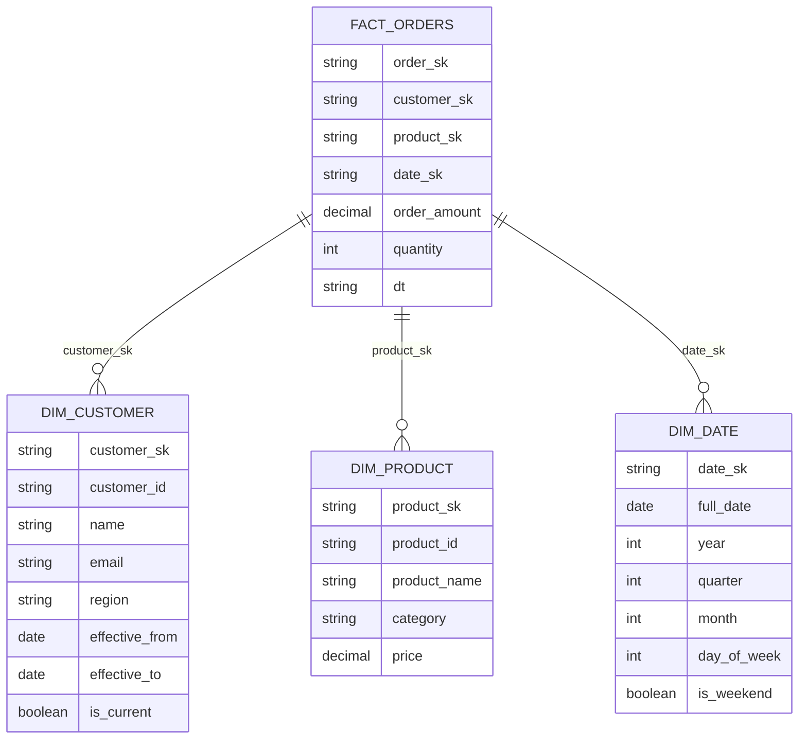

# Data Modeling

## Medallion rationale

The pipeline stores data in three layers, each with a clear contract:

| Layer | Contents | Contract |
|---|---|---|
| Bronze | As-received records from `validated/`, repackaged as Parquet | Append-only, no cleaning, no dedupe — the replayable source of truth |
| Silver | Cleaned, typed, deduplicated, conformed entities | One row per logical event/order; schema-enforced; still partitioned by `dt` |
| Gold | Star schema for analytics | Surrogate keys, SCD-managed dimensions, partitioned by `dt` |

The point of the layers is isolation: source quirks stop at bronze, cleaning decisions live in silver, and gold is the stable interface analysts build on. If a transform rule changes, you rebuild downstream layers from bronze instead of re-extracting from sources.

## Star schema

- `fact_orders` — one row per order line; all dimension references are surrogate keys; `dt` partition column mirrors the ingestion date.
- `dim_date` — pre-generated calendar table; no SCD behavior.
- `dim_customer` — SCD Type 2 (history kept).
- `dim_product` — SCD Type 1 (overwrite).

## SCD Type 1 vs Type 2

**Slowly Changing Dimensions** describe how a dimension reacts when a source attribute changes.

### Type 1 — overwrite (`dim_product`)

When a product attribute changes (e.g., price or category), the row is updated in place. Old values are discarded.

- Use when: history doesn't matter for the metric — a price correction or recategorization should be reflected for all time.
- Trade-off: you lose the previous value; you cannot answer "what category was this in when the order was placed."

### Type 2 — versioned history (`dim_customer`)

When a customer attribute changes (e.g., region or email), the current row is closed (`effective_to` set, `is_current = false`) and a new row is inserted with a new surrogate key (`effective_from` set, `is_current = true`). The natural key (`customer_id`) repeats across versions.

- Use when: history matters — revenue-by-region reports must reflect the region the customer was in *at the time of the order*.
- Trade-off: the dimension grows with changes; joins must filter `is_current = true` or pick the version valid at the fact's date.

The kit ships with `dim_product` as SCD1 and `dim_customer` as SCD2 because customer attributes (region, segment) are the ones analysts typically need history for, while product master corrections are usually intended retroactively. See `docs/extending.md` for converting `dim_product` to SCD2.

## Surrogate key strategy

Surrogate keys are generated deterministically with `sha2` over the natural key:

- `dim_customer.customer_sk = sha2(customer_id + effective_from)` — unique per SCD2 version.
- `dim_product.product_sk = sha2(product_id)` — stable per product (SCD1).
- `fact_orders.order_sk = sha2(order_id)` — stable per order line.
- `dim_date.date_sk = sha2(yyyymmdd)` — or a simple `yyyymmdd` integer; the date table is static.

Deterministic keys make the pipeline idempotent: reprocessing the same `dt` partition regenerates identical keys, so downstream joins and merges stay consistent across reruns.

## Partitioning strategy

All layered tables are partitioned by `dt` (the ingestion/business date, `yyyy-MM-dd`):

- **Pruning.** Athena and Spark skip entire partitions that don't match a `dt` filter — this is the single biggest lever for both query speed and cost (Athena bills per byte scanned).
- **Idempotency.** Each run writes a complete `dt` partition with overwrite semantics, so retries and reruns are safe.
- **Incrementality.** New data adds new partitions; historical partitions are only rewritten when explicitly backfilled.

## Idempotency notes

1. Landing → validation: S3 event deliveries can repeat, and Lambda can retry — validation is a pure function of the object contents, so reprocessing the same object writes the same `validated/` output.
2. Bronze → silver → gold: every stage does a full partition overwrite for `dt`, so a Glue job rerun (manual or retry) leaves exactly one copy of that day's data.
3. SCD2 merge: the merge into `dim_customer` is keyed on natural key + effective range, so rerunning the merge for the same `dt` closes the same rows and opens the same versions — no duplicates.
4. dbt marts: mart models are built per-`dt` and overwritten on rerun (full-refresh of the affected partitions, not append).

Practical consequence: if anything fails mid-run, the safe recovery is always "fix and rerun for that `dt`" — never manual deletes.
